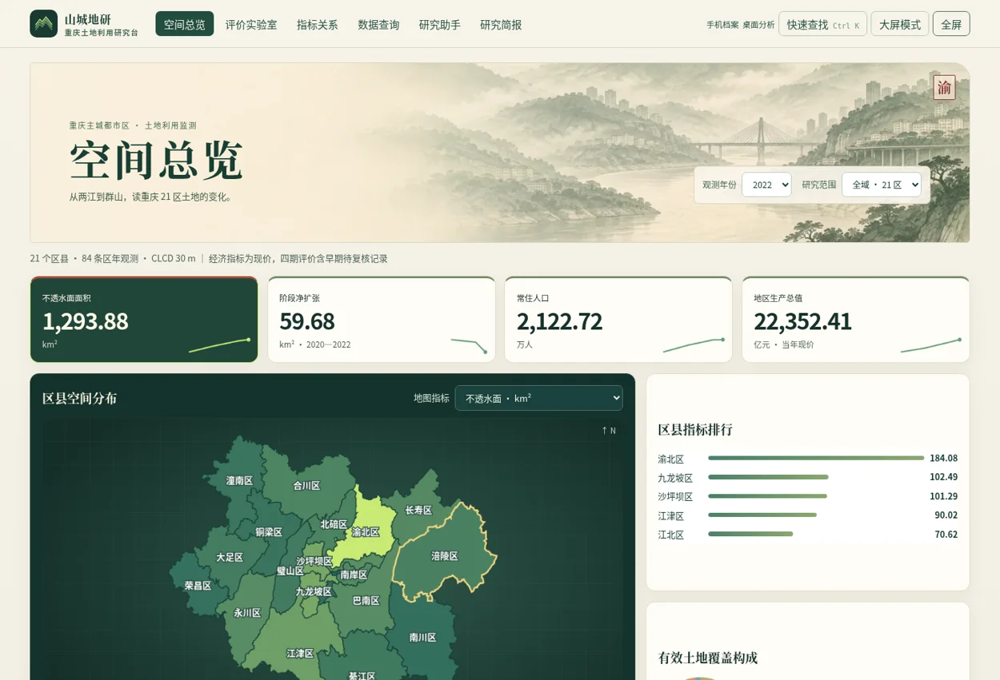
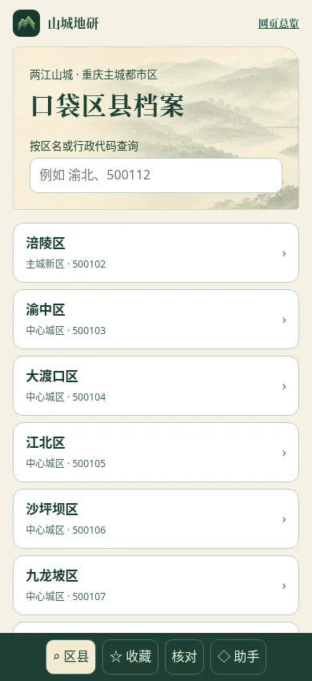
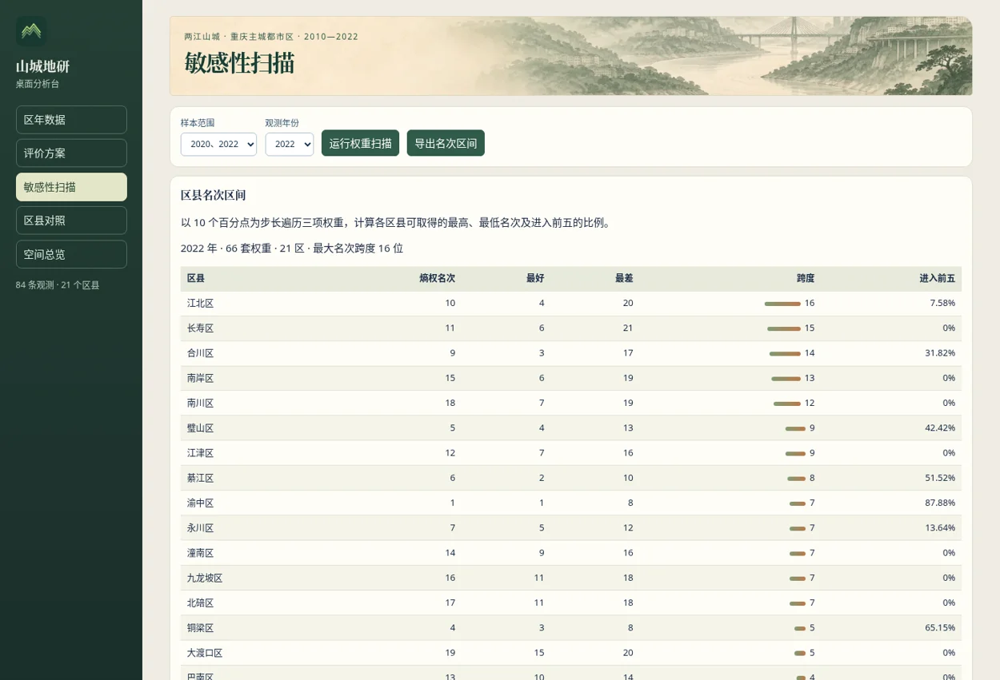

# 重庆市主城都市区建设用地扩张与集约利用评价

《基于多源国土空间数据的重庆市主城都市区建设用地扩张时空格局与集约利用评价系统设计与实现》
# 山城地研界面预览

## 网页空间总览


## 手机口袋区县档案


## 桌面敏感性扫描



研究范围为中心城区 9 区和主城新区 12 区，时点为 2010、2015、2020、2022 年。系统从四期土地覆盖栅格提取区级建设用地面积及变化，关联人口和经济统计，生成熵权 TOPSIS 评价、分组统计和 WebGIS 地图。

- [毕业论文 Word 版](docs/毕业论文.docx) · [可编辑 Markdown 源稿](docs/thesis.md)
- [分析与验证报告](docs/validation.md)
- [数据来源、字段和口径对照](docs/data.md)
- [公开替代数据实查](docs/alternatives.md)
- [四期不透水面扩张实证结果](docs/landcover-results.md)
- [集约利用实证和三份数据交付](docs/socioeconomic-results.md)

## 工程验收与数据审计

- [五阶段实施与验收清单](docs/acceptance.md)
- [数据质量与可追溯性验证](docs/validation.md)
- [部署与运行手册](docs/deployment.md)

运行 **python audit_study.py --output outputs/data-audit** 可对 21 区、84 条区年记录、63 条扩张记录、5,103 个地类转移单元、评价结果和展示边界执行一致性检查，并生成带 SHA-256 输入指纹的 JSON/Markdown 报告。审计通过不替代年鉴原件、CLCD 原始版本和行政边界基准的外部核验。

## 运行山城地研

| 客户端 | 启动方式 |
| --- | --- |
| 网页、大屏 | 在仓库根目录运行下方命令，访问 `http://127.0.0.1:8000/` |
| Android 8+ | 执行 `bash clients/android/build.sh`（需 Android SDK API 35）构建；生成的 APK 位于本机 downloads 目录，当前仓库不跟踪该二进制 |
| iPhone | 用 Safari 打开 HTTPS 部署地址的 `/mobile.html`，添加到主屏幕 |
| Windows x64 | 执行 `sh clients/desktop/portable/build.sh`（需 Go 1.24）构建 Windows x64 与 Linux x64 程序 |
| Linux x64 | 使用仓库内 [Linux 桌面程序](downloads/cq-land-linux)，或重新执行上述构建脚本 |
| Python 桌面 | 执行 `python clients/desktop/package.py` 生成 pyz，再运行生成文件；需 Python 3.10+ 和 Tkinter |

```bash
python -m venv .venv
source .venv/bin/activate
python -m pip install -r requirements.txt
python manage.py migrate
python manage.py import_study
python manage.py runserver
```

快捷查找支持 Ctrl+K 或 ⌘K。大屏支持四期轮播、地图点选与缩放、地类构成和逐区地类转移矩阵。评价实验室支持熵权、等权、自定义权重和单区情景试算。研究助手可检索区县、对照指标、解释矩阵和试算结果。网页在 HTTPS 或本机地址上支持离线缓存。

网页可选接入本机 Ollama。启动 Ollama 并准备模型后，设置 `CQ_OLLAMA_MODEL` 并启动 Django。摘要输入由研究台按当前数据计算，模型选出的相关证据单独显示。离线客户端内置统计问答。

网页版 `/mobile.html` 和 `/desktop.html` 可直接体验两个专用界面。网页研究简报随年份及区组更新，可加备注并打印为 PDF。桌面分析台支持跨年筛选、按列排序、保存评价方案、对照排名和导出差异。

新版采用重庆两江与山城为题的淡墨卷首。网页可在指标关系图中选择两项变量并联动地图，桌面可批量扫描 66 套权重，手机可建立待核对清单并按年份比较不透水面变化。

[新版界面预览](docs/landscape-interface.md) · 安装包复建方法、三端设计和数据口径见 [三端应用说明](docs/workbench.md)。

## 重庆三维大屏

「两江立体图」提供区县画像、四期土地覆盖、增减变化、虎溪三维建筑、设施周边分析、视图保存、CSV 和 PNG 导出。网页地址为 `/city.html`，桌面端可从侧栏进入。 [操作与数据来源](docs/city-atlas.md) · [三维界面预览](docs/landscape-interface.md#两江立体图)

## 数据处理与机器学习

Django 分析中心使用 ECharts 展示全域趋势、地类转移热图、时间留出的回测对照和聚类结果。使用仓库中的数据或原始 GeoTIFF 复算研究结果，详见 [技术栈、部署与分析复现](docs/data-platform.md)。生成的表、模型误差和逐区回测值位于 [results/analysis](results/analysis)。

## 运行模拟数据

需要 Python 3.12。以下命令从仓库根目录执行。

```bash
python -m venv .venv
source .venv/bin/activate
python -m pip install -r requirements.txt
export MPLCONFIGDIR="$PWD/.cache/matplotlib"
export XDG_CACHE_HOME="$PWD/.cache"
python demo.py
python -m unittest discover -s tests -v
python serve.py --results outputs/demo
```

浏览器打开 `http://127.0.0.1:8000/`。地图和统计值来自合成夹具，页面会标出数据类型。

## 复算实测数据

仓库随附已算好的汇总表和应用数据。若有本项目使用的 `cq_landcover.zip`，解压到 `inputs/` 后可逐像元重现附件口径。从仓库根目录运行：

```bash
python audit_landcover.py inputs/cq_landcover/out --output outputs/landcover
python evaluate_observed.py \
  --socio results/socioeconomic/socio_21district_4year.csv \
  --landcover outputs/landcover \
  --boundaries inputs/cq_landcover/out/boundaries/CQ_Metro21_districts_wgs84.geojson \
  --output outputs/evaluation
```

### 使用其他完整覆盖栅格

先按[数据说明](docs/data.md)准备四期栅格、研究区边界和 84 条区级统计。以下命令中的类别编码 8 应与所获取 CLCD 版本的分类表核对。

```bash
python spatial.py \
  --boundaries inputs/boundaries.geojson \
  --statistics inputs/statistics.csv \
  --raster 2010 inputs/clcd-2010.tif --raster 2015 inputs/clcd-2015.tif \
  --raster 2020 inputs/clcd-2020.tif --raster 2022 inputs/clcd-2022.tif \
  --built-class 8 --data-kind observed --output outputs/observed
python serve.py --results outputs/observed
```

输出包括区级面板 `district_year.csv`、熵权 `weights.csv`、分组汇总 `groups.csv`、分阶段关联 `association.csv`、趋势图 `trends.png`、自动生成的描述报告 `report.md` 和 WebGIS 数据。首期阶段变化字段为空。

## 使用 PostGIS

在 PostgreSQL 16 和 PostGIS 3.5 中新建专用数据库。已有数据库时，先设置标准 PostgreSQL 连接参数 `PGHOST`、`PGPORT`、`PGUSER`、`PGDATABASE`，并通过本机 PostgreSQL 身份验证机制配置密码。以下命令会替换该数据库 `land_use` 模式中的研究数据，用独立数据库分别存放实测和模拟数据。

```bash
(cd results/socioeconomic/four-year-exploratory && psql -f ../../../sql/load.sql)
python serve.py --postgis
```

安装容器版时，可用 `postgis/postgis:16-3.5` 镜像。将输出目录拷入容器后，在容器内该目录执行 `psql -f`，或从宿主机通过已配置的数据库端口执行上述命令。WebGIS 支持年份、区组和指标筛选，可点击地图或使用表格选择区县。
