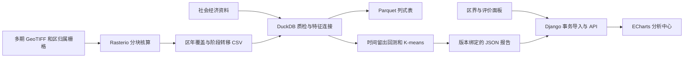

# Django 数据与分析平台

## 技术栈与分层

| 层 | 技术 | 职责 |
|---|---|---|
| 空间数据 | Rasterio、NumPy、30 米 CLCD | 分块读取对齐的分类栅格及区归属栅格，核算土地覆盖、缺测、变化形态和地类转移 |
| 列式分析 | DuckDB、ZSTD Parquet | 导入和检查区年表、阶段转移表及社会经济表，执行聚合及期初特征连接 |
| 模型 | scikit-learn | 回测训练中位数、岭回归与随机森林，按期初特征做探索性聚类 |
| 业务服务 | Django 5.2 LTS、ORM、SQLite | 迁移、事务导入、带筛选的 JSON 接口和后台核查。研究地图可以从已有 PostGIS 快照读取 |
| 报表 | Apache ECharts 6.0.0 | 趋势、地类热图、误差、逐区回测、分组散点。资源固定版本并随应用发布 |
| 部署 | Python 3.12、Gunicorn、Docker | 锁定依赖、可重复构建，生产实例位于 HTTPS 反向代理后 |



## 环境搭建

本地建 Python 3.12 虚拟环境，安装 requirements.txt 后执行以下命令。后台需要本地管理账号，可用 `python manage.py createsuperuser` 创建。观测面板通过导入命令更新，管理页可查看来源字段。

```bash
python manage.py migrate
python manage.py import_study
python manage.py test study
python manage.py runserver
```

容器版可在仓库根目录运行 `docker build -t cq-study-django:local .`，再执行 `docker run --rm -p 127.0.0.1:8000:8000 cq-study-django:local`。镜像构建时导入仓库数据。若网络代理采用组织证书，构建可通过 `--secret id=pip_ca,src=/path/to/ca-bundle.crt` 提供可信证书链。公开部署设置 `DJANGO_DEBUG=0`、`DJANGO_SECRET_KEY` 和 `DJANGO_ALLOWED_HOSTS`，让 HTTPS 反向代理服务 `collectstatic` 生成的后台静态文件。仅在代理清理并重写转发协议请求头时设置 `DJANGO_TRUST_PROXY=1`。开发回环地址可选配置 `CQ_OLLAMA_MODEL`，接口受 Django CSRF 中间件保护。

| 入口 | 内容 |
|---|---|
| `/` | 地图、评价、分析中心和报表 |
| `/admin/` | 区县与观测来源核查 |
| `/api/v1/observations/?year=2022&district=500112` | 以年份和代码筛选区年记录 |
| `/api/v1/analysis/` | 数据处理统计、回测结果、聚类和全域汇总 |
| `/dashboard.json`、`/districts.geojson` | 兼容三端现有客户端 |

分析报告使用研究面板指纹核验版本。导入其他面板后可继续浏览地图和观测，固定实测报告会提示版本冲突。原有 `serve.py --results` 和 `--postgis` 入口使用对应独立快照，固定分析报告按原有实测面板打开。

## 数据处理与复现

仓库已保留区年覆盖、阶段变化、转移、社会经济和期初机器学习特征的 Parquet 表。默认从经核对的 CSV 重建。如已获得原始栅格，可让 Django 命令先调用 Rasterio 分块复算后，再进入列式分析流程。

```bash
python manage.py build_analysis
python manage.py build_analysis --rasters /path/to/cq_landcover/out
```

本次输入为四张 7,957 × 7,785 栅格共约 2.48 亿个网格位置，包含区外和未覆盖位置。下游共有 84 条区年覆盖、63 条区级阶段变化、5,103 个地类转移单元和 84 条社会经济记录。模型层样本为 63 条。DuckDB 检查输入条数、主键和像元面积，生成表与源文件 SHA-256 一起登记。栅格采用窗口读取，CPU 与内存开销和像元纵横尺寸、窗口行数相关。当前规模适合单机分块与列式计算。增加其他市域后可按年份与地区分区扩展 Parquet 数据。

以下 DuckDB 查询返回 2020—2022 年耕地向不透水面的面积。

```python
import duckdb
print(duckdb.sql("""
    SELECT round(sum(area_km2), 4)
    FROM read_parquet('results/analysis/flow.parquet')
    WHERE "end" = 2022 AND from_class = 1 AND to_class = 8
""").fetchone())
```

## 回测口径与结论

预测目标为阶段不透水面的年均净扩张量。取阶段期初不透水面、林地比例、耕地比例、水体比例和常住人口。训练使用 2010—2015 和 2015—2020 的 42 条观测。2020—2022 的 21 条观测独立留出，预处理由训练数据拟合。固定算法和超参数。留出区县曾出现在训练集，成绩描述同一组区县的跨期回测。部分早期经济字段待复核，本模型特征采用人口和覆盖数据。

| 方法 | MAE（km²/年） | RMSE（km²/年） |
|---|---:|---:|
| 训练中位数基线 | 0.969 | 1.119 |
| 岭回归 | 2.172 | 2.647 |
| 随机森林 | 1.958 | 2.369 |

该次留出中，中位数基线表现最好。结论用于比较建模方法和历史区县扩张特征，后续预测需要更多时相及外部验证。K-means 对 2020 年五项期初特征标准化后分三组，组号只区分样本特征。轮廓系数和区县归组结果见分析中心。

## 重庆地域景观与资料

卷首保留两江、桥梁和坡地组团的淡墨插画。地图「两江水系」开关可叠加长江与嘉陵江的真实公开中心线。按 Natural Earth 的公开 1:10m 产品裁切到研究区边界周边。图层是小比例尺环境参照，土地覆盖和转移统计继续使用统一栅格。 [Natural Earth 固定源数据](https://github.com/nvkelso/natural-earth-vector/blob/ca96624a56bd078437bca8184e78163e5039ad19/geojson/ne_10m_rivers_lake_centerlines.geojson) · [Natural Earth 授权说明](https://www.naturalearthdata.com/about/terms-of-use/)

基础视觉采用暖纸、墨绿和朱砂。卷首为插画，地图和报表按真实观测绘制。重庆市政府与维基共享资源站点在开发环境被代理拦截，本版的外部空间资料采用可获取且许可清晰的 Natural Earth。
