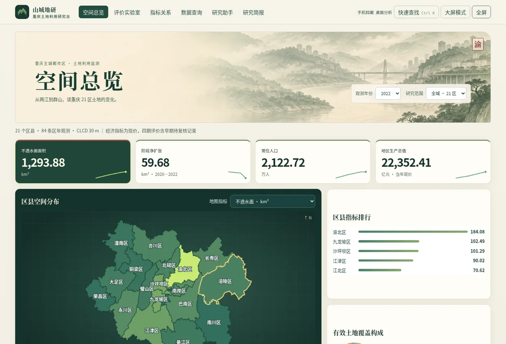
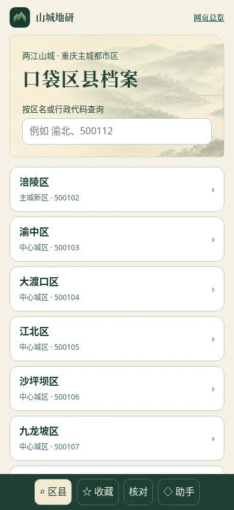
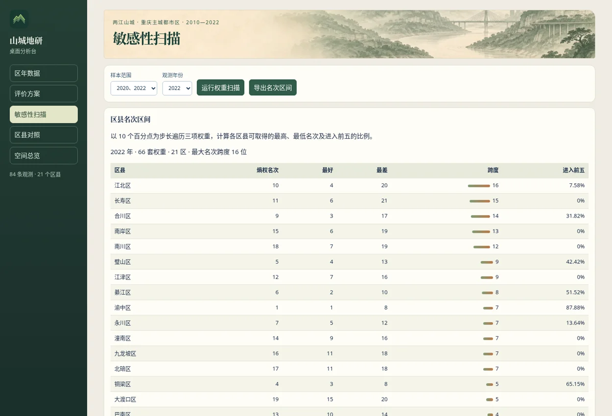
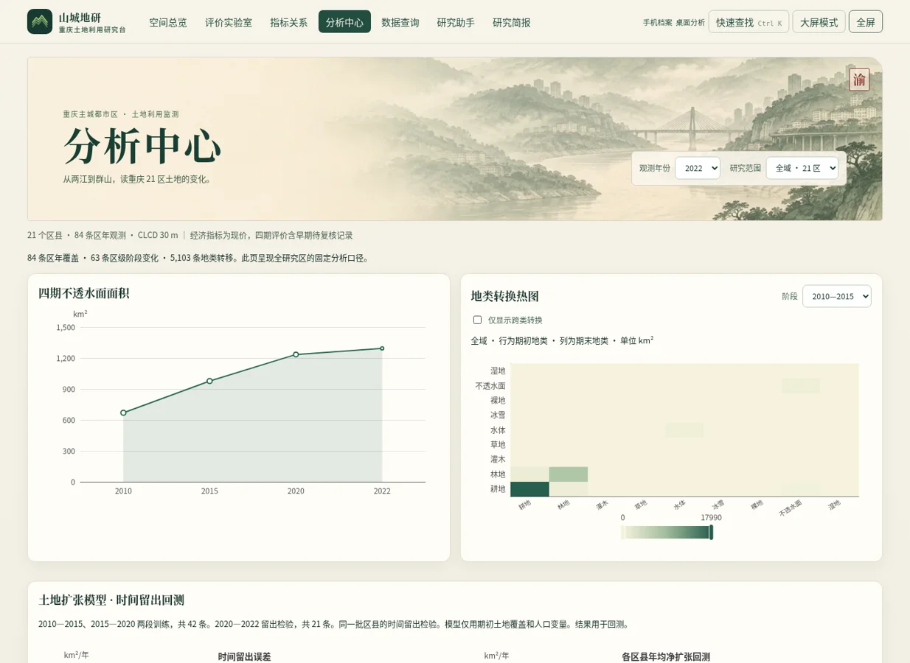
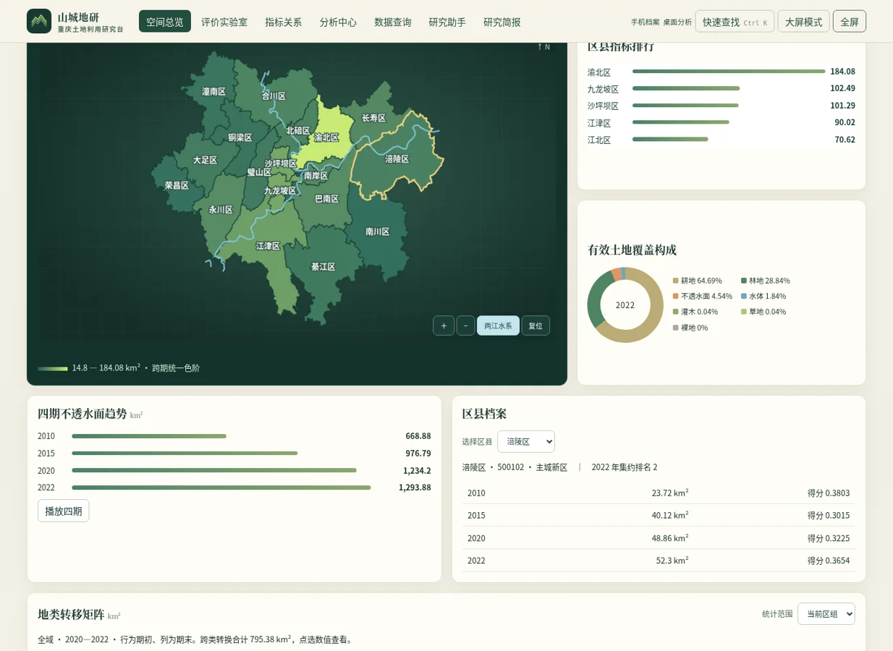
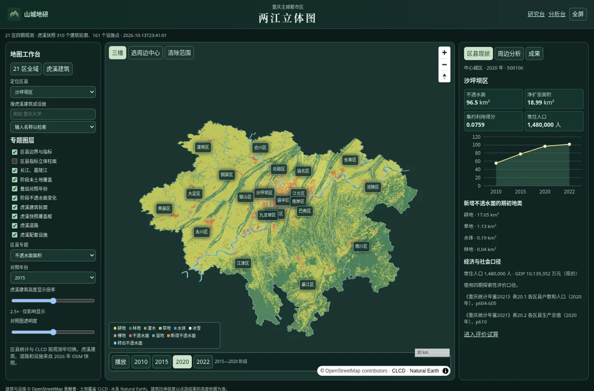
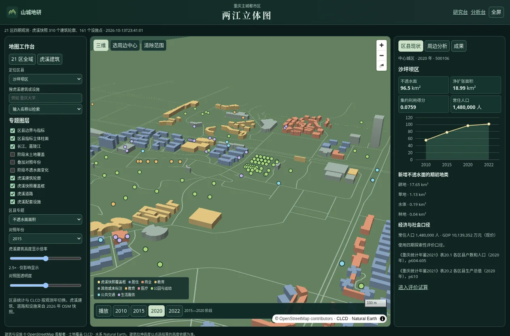

# 山城地研界面预览

## 网页空间总览

淡墨卷首表现两江、桥梁和坡地街区。地图保持墨绿底色，排列观测指标、区县分布和覆盖构成。

## 手机口袋区县档案

底部入口连接四期档案、收藏、待核对清单和离线问答。

## 桌面敏感性扫描

比较区县在不同权重下的名次上下限，并导出可复核的结果表。

## 统计与模型报表

Django 提供经过版本绑定的报告数据，ECharts 绘制趋势、转移与模型回测。

## 两江水系

浅蓝中心线显示公开的长江、嘉陵江地理参照，卷首绘画表现山城地域景观。

## 两江立体图

网页三维工作台的全域土地覆盖与区县趋势。

虎溪片区的三维建筑轮廓、道路与设施。依据实际标注或示意高度拉伸，详细口径见 [两江立体图说明](city-atlas.md)。

