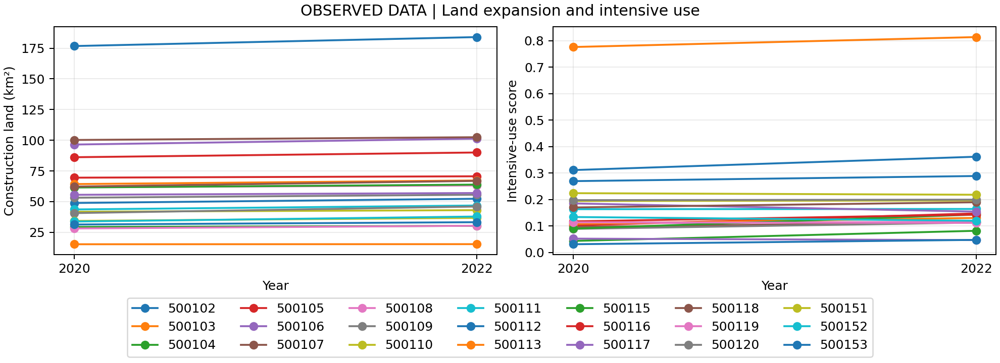

# 基于多源国土空间数据的重庆市主城都市区建设用地扩张时空格局与集约利用评价系统设计与实现

毕业设计论文

## 摘要

本文设计并实现一套面向重庆市主城都市区的建设用地扩张分析与集约利用评价系统。研究单元为中心城区和主城新区的 21 个行政区，分析时点设为 2010、2015、2020 和 2022 年。系统统一多期分类栅格的空间参考与像元网格，在固定区界内提取建设用地规模、净增长、新增与减少面积、邻接形态和用地重心位移。人口承载密度、单位建设用地地区生产总值和单位建设用地第二产业增加值经统一标准化后，采用熵权 TOPSIS 计算相对集约利用得分，并用等权结果检验排名敏感性。系统利用 PostGIS 管理区界和评价结果，通过 WebGIS 提供地图和分项指标查询。合成数据实验覆盖 21 区四期观测，验证了面积核算、面板匹配、空间查询与浏览器交互。附件栅格复算显示，2010—2022 年研究区有效范围内不透水面净增 625.00 km²，三个阶段的年均净增依次为 61.58、51.48 和 29.84 km²。2020、2022 年以 42 条较高质量观测计算集约利用，渝中区、涪陵区与荣昌区两期均列前三。2020—2022 年扩张强度与期末得分的 Spearman 系数为 −0.378。2010、2015 年经济分项纳入探索性评价并保留口径限制。

**关键词**　建设用地扩张，土地集约利用，CLCD，熵权 TOPSIS，WebGIS

## Abstract

This study designs and implements a system for analysing construction-land expansion and evaluating intensive land use in the Chongqing metropolitan area. The study covers 21 districts in 2010, 2015, 2020 and 2022. Aligned categorical rasters and fixed district boundaries support the estimation of land area, gains and losses, adjacency of new cells, and changes in the centroid of construction land. An entropy-weighted TOPSIS model combines population and economic output densities. Equal-weight TOPSIS provides a ranking sensitivity check. A PostGIS database and a WebGIS dashboard expose district geometry and results. A synthetic panel demonstrates the processing and visualization workflow. Recalculation from the supplied land-cover rasters shows a net increase in impervious surface of 625.00 km² from 2010 to 2022. A separate evaluation based on 42 district-year observations in 2020 and 2022 places Yuzhong, Fuling and Rongchang in the top three in both years. Expansion intensity and the 2022 score show a descriptive Spearman correlation of −0.378. Early economic data were retained only in an exploratory analysis due to extraction and historical-boundary uncertainty.

**Keywords**　construction-land expansion, intensive land use, CLCD, TOPSIS, WebGIS

## 第 1 章 绪论

建设用地扩张描述既有土地覆盖转向建设活动所对应的空间增量。集约利用评价关注既定用地规模承载的人口与经济活动。在山地城市中，地形与河流对空间形态的影响使区级用地增长具有较高的研究价值。并列考察扩张和集约程度，可以呈现面积增长、单位用地承载能力和经济效益的不同变化维度。

重庆是直辖市。研究以区级行政单元为基本尺度，采用中心城区 9 区加主城新区 12 区方案。全市 38 区县方案具有全域视角，数据整理工作量较高。中心城区 9 区可突出山地城市形态，区际比较范围较窄。单区方案若需开展横向评价，通常要补充街镇级数据。21 区方案可对照中心与外围开发梯度，并保持空间计算和统计口径核查的工作量可控。

本文研究三个问题。第一，三个研究阶段的用地新增、减少、净扩张和重心变化如何分布。第二，阶段间和两区组间的相对集约利用水平如何变化，排名受权重选择影响多大。第三，如何将栅格处理、统计评价、空间入库与地图查询组织为可复现流程。

## 第 2 章 研究区和数据

研究使用附件提供的 CLCD 四期土地覆盖分类、固定区归属栅格和统计年鉴转录的区县资料。CLCD 基于 Landsat 观测提供长期土地覆盖信息，可用于跨年土地覆盖变化研究。本文以对应不透水面的分类作为遥感建设用地操作定义。国土调查法定建设用地与城建统计建成区各有自己的定义和范围。

使用同一套边界提取四期面积，可以保持空间分母的一致性。统计资料须按相同区界重新核对，包括 2010 年的区县拆并和功能区。处理表记录原始单位、具体表号、经济价格、合并依据和文件版本。四期共 84 条面板记录。每一阶段的区际关联单独分析，避免把同一区跨期记录当作独立样本。

人口采用常住人口，经济效益采用 GDP 和第二产业增加值。使用同一基期价格可以减少通胀对跨期比较的干扰。若只能获得现价数值，结果以名义产出密度表述，并在讨论中限制跨期推论。数据要求见 [数据目录与口径](data.md)。

## 第 3 章 扩张格局和集约利用方法

### 3.1 区域面积与空间形态

实证分析直接使用附件已经对齐的 30 米 Albers 等积网格与同网格区归属栅格，以 256 行为一块读取，并为邻接判定读取周边一像元。四期采用相同有效像元范围，避免缺测范围变化混入面积变化。通用导入流程可将其他完整覆盖的分类栅格通过最近邻重采样统一至 EPSG:6933。建设用地面积 \(A_{it}\) 等于建设用地像元数乘以 0.0009 km²，行政区面积 \(S_i\) 由等积投影几何计算。

阶段 \(s\) 至 \(t\) 的净扩张面积为 \(\Delta A=A_{it}-A_{is}\)。复合年均增长率为 \(100[(A_{it}/A_{is})^{1/(t-s)}-1]\%\)，年均扩张强度为 \(100\Delta A/[S_i(t-s)]\%\)。新增和减少通过同一像元的类别转换确定，二者差额应与净扩张相符。

新增像元的四邻域若包含期初建设用地，则判为邻接新增。四邻域均有值且无期初建设用地时，判为非邻接新增。无已知建设用地邻居且邻域含缺测时，单列为邻接未知。该定义描述像元尺度空间邻接，受分辨率和邻域规则影响。建设用地重心以区内建设用地像元中心等权平均得到。比较相邻年份的重心坐标获得位移和相对投影网格北的方向。重心汇总同时受新增与减少影响，不能揭示所有局部扩张过程。

### 3.2 熵权 TOPSIS

评价指标为常住人口、GDP、第二产业增加值各自除以同年的区级建设用地面积。各指标为正向指标。在每套评价的全部区年观测上做极差标准化。2020、2022 年主分析使用 42 条记录，四期探索分析使用 84 条。各套结果对应自己的参照范围。常数指标记为零权重并从求距空间中剔除。令 \(z_{ij}\) 为标准化值，\(p_{ij}=z_{ij}/\sum_i z_{ij}\)。信息熵为 \(e_j=-\sum_i p_{ij}\ln p_{ij}/\ln n\)，其中 \(0\ln 0=0\)。权重为 \(w_j=(1-e_j)/\sum_j(1-e_j)\)。

对 \(w_jz_{ij}\) 取列最大值和最小值形成正、负理想点。样本到两理想点的欧氏距离分别记为 \(D_i^+\) 和 \(D_i^-\)。接近度为 \(C_i=D_i^-/(D_i^++D_i^-)\)，分值范围为零至一。区级名次在各年份内部计算。等权 TOPSIS 使用相同的标准化样本，可用于观察评价权重对排序的影响。

GDP 包含第二产业增加值，两项使用相同面积分母。在 2020、2022 年 42 条观测中，单位建设用地 GDP 和二产的 Spearman 相关系数为 0.731，人口密度与上述两项的相关系数分别是 0.559 和 0.440。指标间存在信息重叠，等权对照用于判断排序对权重的敏感程度。评价覆盖承载与产出密度，无法直接代表生态效益、土地投入或社会公平。

### 3.3 分组与关联

报告分别比较中心城区和主城新区的土地规模和区级得分均值。均值是区级等权平均。各阶段使用 Spearman 系数描述区级年均扩张强度与期末得分的单调关系。由于面积分母、空间依赖和区际结构差异，系数仅用于描述，不能单独识别作用机制或证明因果关系。

## 第 4 章 系统设计与实现

系统由离线分析、数据存储、查询服务和浏览器页面组成。Python、Rasterio 和 Shapely 完成栅格对齐、空间分块及区界校验。评价程序生成区年面板、分组统计、权重和描述报告，并输出 GeoJSON 与 JSON。PostGIS 以行政代码关联边界表和区年观测表，区界列创建 GiST 空间索引，区划代码和年份共同构成观测主键。数据导入在事务内执行，区界数量和观测数量校验失败会回滚。

浏览器通过 HTTP 获取研究边界与评价记录。地图提供年份、区组和指标筛选，同一区组切换年份时采用统一色阶。区级表格支持键盘操作，用户可选择行政区查看新增、减少、集约得分和历年指标，也可导出当前筛选结果。系统既能直接读取分析输出，也能通过 PostGIS 读取同一结构的数据。

## 第 5 章 系统实验与实证分析

### 5.1 系统验证

合成测试构造 21 个无重叠区界、四期分类栅格和 84 条统计记录，包含连续新增、非邻接新增和建设用地减少。渝中区代码对应的合成单元在 2015 年合计 16 个建设用地像元，新增 8 个，减少 1 个，其中 6 个邻接新增，2 个非邻接新增。自动测试检查面积平衡、得分范围、权重和与缺失面板拦截。数据库验收验证了入库、覆盖查询和浏览器筛选。细节见 [分析与验证报告](validation.md)。

### 5.2 扩张规模与空间形态

附件实测复算采用原生 30 米 Albers 网格与区归属栅格。2010、2015、2020、2022 年的不透水面面积分别为 668.8755、976.7943、1,234.2015 和 1,293.8787 km²。2010—2022 年净增 625.0032 km²，增幅 93.44%。三个阶段年均净增由 61.58 km² 降至 29.84 km²。主城新区在 2020—2022 年净增 36.37 km²，占该阶段总增量的 60.95%。区级累计净增以渝北区最高。附件汇总表经 84 条区年重算验证。详见 [四期不透水面扩张实证结果](landcover-results.md)。

| 阶段 | 新增（km²） | 减少（km²） | 净增（km²） | 邻接新增占比 |
| --- | ---: | ---: | ---: | ---: |
| 2010–2015 | 319.24 | 11.32 | 307.92 | 17.9% |
| 2015–2020 | 263.01 | 5.60 | 257.41 | 28.1% |
| 2020–2022 | 61.70 | 2.03 | 59.68 | 38.7% |

三个阶段邻接新增占全部新增的比例上升，同时绝对新增量下降。渝北区三个阶段的不透水面重心位移分别为 2.10、1.72、0.27 km，相对网格北的方向角分别为 60.7°、48.3°、36.5°，总体向东北移动。该结果描述合计像元的空间重心，区内局部扩张仍可能朝不同方向。

167.0256 km² 研究区像元四期均缺测，因此面积和变化结论适用于共同有效范围。展示边界由 DataV 点位经 GCJ-02 反解转换为 WGS84，区级图不作为测绘成果。统计仍采用附件原生网格，边界配准误差尚未量化。未知邻域面积已单列。

### 5.3 集约利用与扩张关联

同期人口、GDP 和第二产业增加值已按 21 区与四期土地覆盖关联。2020、2022 年 42 条观测以同一参照计算，人口、GDP 与二产用地密度的权重分别为 0.2025、0.5740、0.2235。两期前三均为渝中区、涪陵区和荣昌区。改用等权后 21 条区年观测名次变化。2020—2022 年扩张强度与期末得分的区际 Spearman 系数为 −0.378。

2020、2022 两期的主分析排名与得分如下。中心城区区级等权得分均值由 0.1562 变为 0.1787，主城新区由 0.1806 变为 0.1906。中心城区包含两期排名首位的渝中区，组内分布仍有明显差异。均值与行政区分组有关，不能直接代表组内总量产出效率。

| 年份 | 第一 | 第二 | 第三 |
| --- | --- | --- | --- |
| 2020 | 渝中区 0.7763 | 涪陵区 0.3110 | 荣昌区 0.2692 |
| 2022 | 渝中区 0.8138 | 涪陵区 0.3615 | 荣昌区 0.2886 |

{width=95%}

### 5.4 敏感性与解释限制

四期探索性比较保留 2010、2015 年经济数据的 B/C 质量标识。以另一附件中 2010 年綦江和大足的经济合并口径作敏感性检验，结果改变 5 条区年名次。由于理想点和熵权基于整个面板，即使早期修改也可能影响后期排名。主要比较使用现价产出，得分变化包含价格因素。区际 Spearman 系数是阶段末的描述统计，不能据此判断扩张与集约利用之间的作用方向。详见 [集约利用评价实证结果](socioeconomic-results.md)。

## 第 6 章 结论与展望

本文实现了统一观测口径、栅格变化提取、集约评价、空间存储与交互查询的工作流，合成实验验证了关键计算和数据接口。附件实测表明，2010—2022 年研究区不透水面增加且年均净增放缓。2020、2022 年集约评价提供了可复现的区际比较，结果对指标权重有一定敏感性。2010、2015 年的跨期解释仍受 OCR 和历史区划口径影响。现有分析以区级尺度和遥感地表分类为基础，后续可在同一数据口径下核验山地坡度、距离水系与道路等空间因素，并增加栅格精度和行政尺度敏感性分析。

## 参考资料

1. Yang J, Huang X. The 30 m annual land cover dataset and its dynamics in China from 1990 to 2019. Earth System Science Data, 2021, 13(8), 3907–3925. [DOI](https://doi.org/10.5194/essd-13-3907-2021)
2. Hwang C L, Yoon K. Multiple Attribute Decision Making. Springer, 1981. [DOI](https://doi.org/10.1007/978-3-642-48318-9)
3. 国家冰川冻土沙漠科学数据中心。CLCD 数据集目录条目。 [数据目录](https://www.ncdc.ac.cn/portal/metadata/9de270f3-b5ad-4e19-afc0-2531f3977f2f)
4. 重庆市统计局。重庆统计年鉴及区县资料入口。 [统计局](https://tjj.cq.gov.cn/)
5. 国家地球系统科学数据中心。重庆市 1:25 万县级行政区划数据集（2014）。 [数据目录](https://www.geodata.cn/main/face_science_detail?guid=4951477&publisherGuid=126744287495912)

6. 重庆市统计局。《重庆统计年鉴 2011》《重庆统计年鉴 2016》《重庆统计年鉴 2021》《重庆统计年鉴 2023》，各区县人口与地区生产总值表。逐项来源见社会经济 CSV。 [年鉴入口](https://tjj.cq.gov.cn/zwgk_233/tjnj/)
7. 中国逐年土地覆盖数据集 CLCD v01。研究采用重庆 2010、2015、2020、2022 年裁剪件。 [数据发布](https://doi.org/10.5281/zenodo.8176941)
